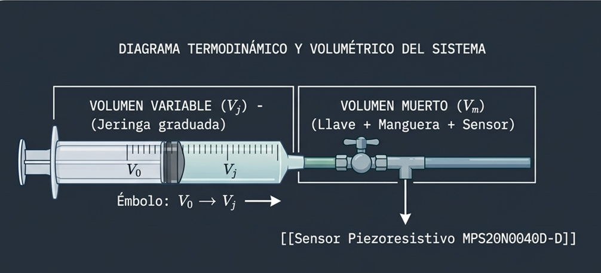
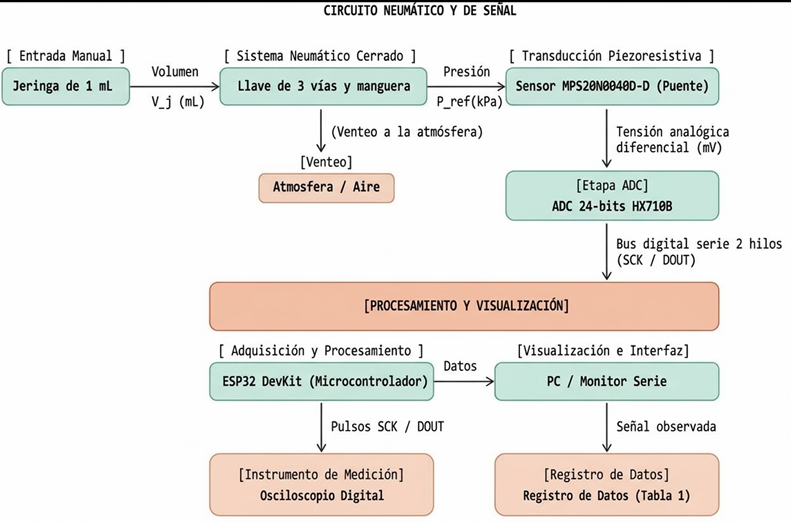
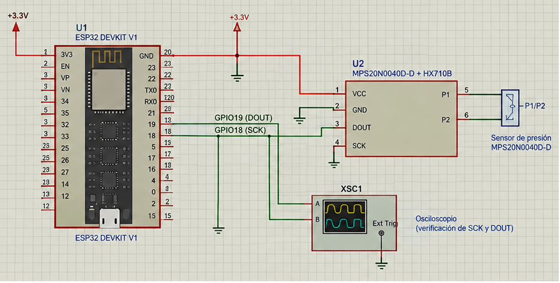
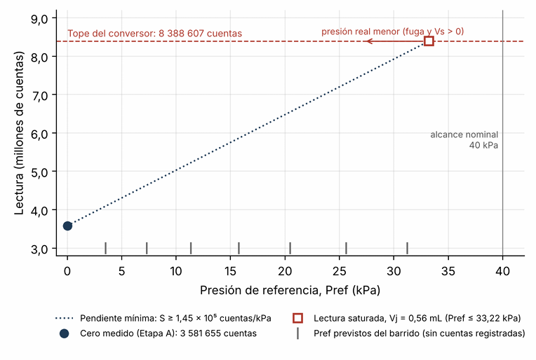

# Caracterización de un Sensor de Presión Manométrica con la Ley de Boyle

**Informe de Laboratorio N.º 2 — Taller de Equipos Biomédicos II**  
*Escuela Profesional de Ingeniería Biomédica — Universidad Nacional Mayor de San Marcos (UNMSM)*

---

## 1. Resumen

En esta experiencia se buscó caracterizar el sensor piezoresistivo de presión manométrica **MPS20N0040D-D** mediante un esquema de compresión volumétrica basado en la Ley de Boyle-Mariotte, empleando un módulo ADC **HX710B** de 24 bits e interfaz con un microcontrolador ESP32. En las pruebas iniciales a presión atmosférica se verificó un nivel de offset base ($C_{0,i}$) de **3 581 655 cuentas** con un ruido de lectura ($\sigma_0$) de **49.38 cuentas**. 

Asimismo, mediante inyección de agua en la vía neumática, se determinó un volumen muerto no desplazable de $V_{\text{med}} = 0.77\text{ mL}$. Debido a una fuga en las uniones del circuito cerrado, el barrido de presiones de la Ley de Boyle se vio limitado por la pérdida de masa constante. A partir de la prueba de hermeticidad en punto de saturación, se determinó una cota inferior de sensibilidad de **$S \ge 1.45 \times 10^5\text{ cuentas/kPa}$** y una cota superior de resolución de **$R_p \le 0.00034\text{ kPa}$ ($0.0035\text{ cmH}_2\text{O}$)**.

---

## 2. Diagrama Termodinámico y de Sistema

El ensayo se fundamenta en la relación isotérmica de Boyle-Mariotte ($P_1 V_1 = P_2 V_2$), donde el volumen total del gas comprende un volumen variable ($V_j$) accionado por la jeringa y un volumen muerto ($V_m$) entrampado en los acoples y el puerto del sensor.


*Figura 1. Diagrama termodinámico y volumétrico del sistema neumático (Jeringa graduada, llave de tres vías y sensor).*


*Figura 2. Diagrama de bloques funcional del circuito neumático, adquisición, procesamiento y visualización.*

---

## 3. Esquemático Eléctrico del Montaje

El transductor piezoresistivo en puente de Wheatstone se acopla al ADC $\Sigma-\Delta$ de 24 bits (HX710B). Las líneas de comunicación serie de dos hilos (SCK y DOUT) se interconectan a los pines GPIO18 y GPIO19 del ESP32, alimentando el módulo a 3.3 V.


*Figura 3. Circuito esquemático de interconexión entre el ESP32 DevKit V1, el módulo HX710B + MPS20N0040D-D y las puntas del osciloscopio.*

---

## 4. Código Fuente de Adquisición (`caracterizacion_presion.ino`)

El firmware implementado en el ESP32 lee los 24 bits del conversor mediante la manipulación directa de reloj en SCK, promedia un bloque de $N=20$ muestras y evalúa la presión de referencia calculada mediante la Ley de Boyle:

$$P_{\text{ref}} = P_{\text{atm}} \cdot \left( \frac{V_0 - V_j}{V_j + V_m} \right)$$

```cpp
#include <Arduino.h>

// Definición de pines para la conexión
#define HX710_DOUT_PIN 19
#define HX710_SCK_PIN  21

// Parámetros y constantes de configuración
const double ATMOSPHERIC_P_KPA = 101.3;  // Presión atmosférica en kPa
const double INITIAL_VOL_ML    = 1.00;   // Volumen inicial en mL
const double DEAD_VOL_ML       = 0.76;   // Volumen muerto en mL
const double MAX_SAFE_P_KPA    = 35.0;   // Límite de seguridad
const double SENSOR_LIMIT_KPA  = 40.0;   // Límite máximo del sensor

// Configuración del promediado de muestras
const int SAMPLE_COUNT = 20;

// Prototipos de funciones
bool readSensorRaw(long &rawData);
bool getAverageAndStdDev(double &meanVal, double &stdDevVal);
double computeReferencePressure(double vj);
double computeMinInjectedVolume();
void displayConfiguration();
void processZeroCalibration();
void processIncomingCommand(String rawInput);

void setup() {
  Serial.begin(115200);
  
  pinMode(HX710_SCK_PIN, OUTPUT);
  digitalWrite(HX710_SCK_PIN, LOW);
  pinMode(HX710_DOUT_PIN, INPUT);
  
  delay(500);
  displayConfiguration();
}

void loop() {
  if (Serial.available() > 0) {
    String inputBuffer = Serial.readStringUntil('\n');
    inputBuffer.trim();
    
    if (inputBuffer.length() == 0) return;

    if (inputBuffer.equalsIgnoreCase("z")) {
      processZeroCalibration();
    } else {
      processIncomingCommand(inputBuffer);
    }
  }
}

// Lectura de datos del módulo HX710B
bool readSensorRaw(long &rawData) {
  uint32_t startTime = millis();
  
  while (digitalRead(HX710_DOUT_PIN) == HIGH) {
    if (millis() - startTime > 1000) {
      return false;
    }
    delay(1);
  }

  uint32_t bitBuffer = 0;
  portMUX_TYPE mutex = portMUX_INITIALIZER_UNLOCKED;
  
  portENTER_CRITICAL(&mutex);
  for (int b = 0; b < 24; b++) {
    digitalWrite(HX710_SCK_PIN, HIGH);
    delayMicroseconds(2);
    bitBuffer = (bitBuffer << 1) | (uint32_t)digitalRead(HX710_DOUT_PIN);
    digitalWrite(HX710_SCK_PIN, LOW);
    delayMicroseconds(2);
  }
  
  digitalWrite(HX710_SCK_PIN, HIGH);
  delayMicroseconds(2);
  digitalWrite(HX710_SCK_PIN, LOW);
  portEXIT_CRITICAL(&mutex);

  if (bitBuffer & 0x800000UL) {
    bitBuffer |= 0xFF000000UL;
  }
  
  rawData = (long)(int32_t)bitBuffer;
  return true;
}

// Cálculo de media y desviación estándar para N lecturas
bool getAverageAndStdDev(double &meanVal, double &stdDevVal) {
  static long samples[SAMPLE_COUNT];
  double sum = 0.0;
  
  for (int i = 0; i < SAMPLE_COUNT; i++) {
    if (!readSensorRaw(samples[i])) return false;
    sum += samples[i];
  }
  
  meanVal = sum / SAMPLE_COUNT;
  
  double sumSquaredDiff = 0.0;
  for (int i = 0; i < SAMPLE_COUNT; i++) {
    double diff = samples[i] - meanVal;
    sumSquaredDiff += diff * diff;
  }
  
  stdDevVal = sqrt(sumSquaredDiff / (SAMPLE_COUNT - 1));
  return true;
}

// Ecuación de la Ley de Boyle
double computeReferencePressure(double vj) {
  return ATMOSPHERIC_P_KPA * (INITIAL_VOL_ML - vj) / (vj + DEAD_VOL_ML);
}

// Cálculo del volumen mínimo inyectable
double computeMinInjectedVolume() {
  double ratio = MAX_SAFE_P_KPA / ATMOSPHERIC_P_KPA;
  return (INITIAL_VOL_ML - ratio * DEAD_VOL_ML) / (1.0 + ratio);
}

// Muestra parámetros de inicialización por puerto serie
void displayConfiguration() {
  Serial.println("# ---- Configuración de Parámetros ----");
  Serial.printf("# Patm = %.3f kPa | V0 = %.2f mL | Vm = %.3f mL | N = %d\n",
                ATMOSPHERIC_P_KPA, INITIAL_VOL_ML, DEAD_VOL_ML, SAMPLE_COUNT);
  Serial.printf("# Límite seguro Vj,min = %.3f mL (Pmax = %.0f kPa)\n", computeMinInjectedVolume(), MAX_SAFE_P_KPA);
  Serial.println("# Opciones disponibles:");
  Serial.println("#   z                 -> Calibración / nivel de cero");
  Serial.println("#   ciclo,sentido,Vj -> Formato de prueba (Ej: 1,C,0.94)");
  Serial.println("# Estructura CSV: ciclo,sentido,Vj,Pref,media,desv,N");
}

// Ajuste del valor cero
void processZeroCalibration() {
  double avg, dev;
  if (!getAverageAndStdDev(avg, dev)) {
    Serial.println("# ERROR: Sin respuesta del módulo HX710B");
    return;
  }
  Serial.printf("# CERO MEDIDO: Promedio = %.2f | Desv = %.2f | N = %d\n", avg, dev, SAMPLE_COUNT);
  Serial.printf("0,Z,%.2f,%.3f,%.2f,%.2f,%d\n", INITIAL_VOL_ML, 0.0, avg, dev, SAMPLE_COUNT);
}

// Procesamiento y validación de comandos ingresados
void processIncomingCommand(String rawInput) {
  rawInput.replace(';', ',');
  rawInput.replace(' ', ',');
  
  int sep1 = rawInput.indexOf(',');
  int sep2 = rawInput.indexOf(',', sep1 + 1);
  
  if (sep1 < 0 || sep2 < 0) {
    Serial.println("# ERROR: Formato incorrecto. Utilice: ciclo,sentido,Vj");
    return;
  }

  int cycle = rawInput.substring(0, sep1).toInt();
  String direction = rawInput.substring(sep1 + 1, sep2);
  double injectedVol = rawInput.substring(sep2 + 1).toDouble();
  
  direction.toUpperCase();

  if (cycle <= 0) return;

  double refPressure = computeReferencePressure(injectedVol);
  double avgVal, devVal;
  
  if (getAverageAndStdDev(avgVal, devVal)) {
    Serial.printf("%d,%s,%.2f,%.3f,%.2f,%.2f,%d\n", 
                  cycle, direction.c_str(), injectedVol, refPressure, avgVal, devVal, SAMPLE_COUNT);
  } else {
    Serial.println("# ERROR: Fallo en la lectura del sensor");
  }
}```

`## 5. Resultados Metrológicos y Respuesta Físico-Digital

### Tabla Consolidada de Parámetros Medidos y Calculados

| Parámetro / Condición | Símbolo | Valor Experimental | Unidad |
| :--- | :---: | :---: | :---: |
| Lecturas promediadas por punto | $N$ | **20** | muestras |
| Offset inicial a presión atmosférica | $C_{0,i}$ | **3 581 655.00** | cuentas |
| Ruido de lectura a cero presión | $\sigma_0$ | **49.38** | cuentas |
| Volumen medio de llave y manguera | $V_{\text{med}}$ | **0.77** | mL |
| Presión atmosférica calculada del laboratorio ($h=75\text{ m}$) | $P_{\text{atm}}$ | **100.40** | kPa |
| Marca de parada de seguridad del émbolo | $V_{j,\text{min}}$ | **0.548** | mL |
| Cota inferior de Sensibilidad | $S$ | **$\ge 1.45 \times 10^5$** | cuentas/kPa |
| Cota superior de Resolución | $R_p$ | **$\le 0.00034$** | kPa |
| Cota superior de Resolución Fisiológica | $R_p$ | **$\le 0.0035$** | $\text{cmH}_2\text{O}$ |

### Gráfico de Lecturas vs. Presión de Referencia ($P_{\text{ref}}$)


*Figura 4. Relación entre la lectura digital en cuentas y la presión de referencia $P_{\text{ref}}$, destacando el punto de cero y la saturación del ADC.*

---

## 6. Componentes e Instrumental Utilizados

* Microcontrolador ESP32 DevKit V1 (Alimentación a 3.3 V)
* Módulo sensor de presión manométrica MPS20N0040D-D (Rango 0–40 kPa) + ADC HX710B de 24 bits
* Jeringas graduadas de 1 mL (Medición volumétrica y neumática)
* Llave de tres vías y tramo de manguera de silicona
* Osciloscopio digital de banco (Verificación del protocolo de comunicación de 2 hilos)
* Protoboard y jumpers de conexión

---

## 7. Integrantes

* **Dávila Pucuhuayla, Jazmín Sarai** — *Código: 23190369*
* **Leon Vasquez, Jimmy Fabricio** — *Código: 23190378*
* **More Quispe, Gregory Martin** — *Código: 23190125*
* **Sotomayor Villanueva, Genny Solangch** — *Código: 23190393*

**Docente:** Dra. María Elisia Armas Alvarado  
**Curso:** Taller de Equipos Biomédicos II — Universidad Nacional Mayor de San Marcos (UNMSM)
